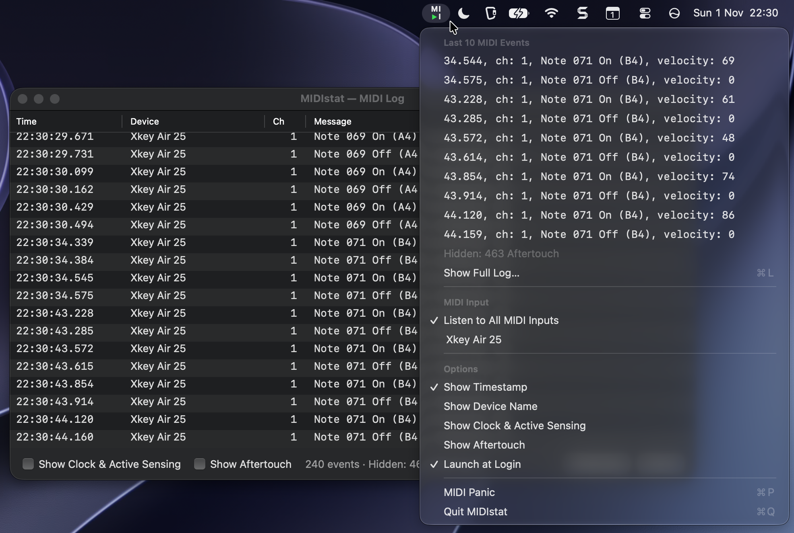

# MIDIstat

A tiny native macOS menu bar app that shows, at a glance, whether MIDI data is arriving — and what it is.



MIDIstat has no Dock icon and no main window. It lives in the menu bar as a two-row **MI / ▶I** mark; the triangle is the indicator:

| Triangle | Meaning |
|---|---|
| $\color{green}{▶}$ **green** | a MIDI message was received within the last second |
| $\color{gray}{▶}$ **grey** | listening, but nothing has arrived for over a second |
| $\color{red}{▶}$ **red** | not listening: there is no MIDI input, or the selected input is disconnected |

The red state applies even if other devices are connected: when a specific input is selected and it disappears, MIDIstat is not listening to anything. It turns grey again automatically when the device comes back.

## Features

### Menu

Click the icon to open the menu:

- **Last 10 MIDI Events**: the most recent messages, oldest first, updated live while the menu is open. Example:
  ```
  4.841, Xkey Air 25, ch: 1, Note 079 On (G5), velocity: 93
  4.911, Xkey Air 25, ch: 1, Note 079 Off (G5), velocity: 0
  ```
  If some message types are hidden (see Options), a line such as `Hidden: 120 Clock / Active Sensing, 3400 Aftertouch` shows how many were left out.
- **Show Full Log…** (⌘L): opens the log window (see below).
- **Show Last Notes** (⌘N, default off): shows or hides the Last Notes window (see below).
- **MIDI Input**:
  - **Listen to All MIDI Inputs**, or
  - one specific input. Inputs are listed live as devices are connected and disconnected. A selected input that is currently unplugged appears as `Name (disconnected)`.
- **Options**:
  - **Show Timestamp** (default on): show the timestamp in the menu list.
  - **Show Device Name** (default on): show the input name in the menu list.
  - **Show Clock & Active Sensing** (default off): include these real-time messages in the event lists.
  - **Show Aftertouch** (default off): include poly pressure and channel pressure in the event lists.
  - **Launch at Login**: start MIDIstat automatically when you log in.
- **MIDI Panic** (⌘P): sends *All Sound Off*, *Reset All Controllers* and *All Notes Off* on all 16 channels to every MIDI output, to silence hanging notes. It is disabled when there are no MIDI outputs. ⌘P also works while the log window has focus, and so do ⌘L and ⌘N.
- **Quit MIDIstat** (⌘Q).

Show Timestamp and Show Device Name affect only the menu list. The log window always shows both.

Show Clock & Active Sensing and Show Aftertouch affect both the menu list and the log window. Hidden messages **still turn the indicator green**; they are only left out of the lists. They are hidden by default because some devices send Clock (~50 per second) or Active Sensing (~3 per second) non-stop, and aftertouch produces a flood of messages while a key is held. Without the filter these would push the notes out of the list in a fraction of a second.

All settings, including the selected input, are remembered between launches.

### Log window

**Show Full Log…** opens a resizable window (it can also be zoomed or made full screen) that lists every message since MIDIstat started, or since the log was last cleared:

- columns **Time** (`HH:mm:ss.SSS`), **Device**, **Ch**, **Message**;
- **Show Clock & Active Sensing** and **Show Aftertouch** checkboxes. These are the same settings as in the menu;
- an event counter, including how many messages are hidden;
- **Clear Log** clears the log window and the menu list;
- **Close** (or Esc).

The window comes to the front when opened. While it has focus, **⌘L** closes it again. Selected rows can be copied with **⌘C** as tab-separated text, ready to paste into a spreadsheet. **⌘A** selects all rows.

The log keeps up to the 100,000 most recent messages per view, which caps memory use when a device sends Clock all the time. The counter says so when the limit is reached.

### Last Notes window

**Show Last Notes** opens a small window, *MIDIstat — Last Notes*, with the last 5 notes played, in large type, for example **G**4 **C**4 **D**4 **A**5 **F♯**4. It is handy when learning: keep it open, press keys and see what you played.

- The newest note appears on the left with a short slide-and-fade animation and pushes the older notes to the right. The oldest note slides out.
- The newest note is shown at full contrast; the older ones are dimmed.
- The note letter and ♯ are bold. The octave number is light, because it is secondary information. Middle C is C4.
- Only key presses (Note On) are shown. Releases and other MIDI messages are ignored. Pressing the same key again adds it again.
- **Always on Top** (default on) keeps the window above other apps, including full-screen ones.
- The window never takes the focus away from the app you are using.
- If the window is open when you quit MIDIstat, it opens again at the next launch. Closing it turns the option off.
- With *Reduce motion* turned on in System Settings → Accessibility, notes appear without animation.

### Message format

Each line has the parts that are switched on: timestamp, device, channel, message.

- **Timestamp**: seconds within the current minute plus milliseconds (`4.841`). The log window shows the full time.
- **Channel**: 1–16. System messages have no channel (`12.345, Start`).
- **Notes**: zero-padded number plus name, with middle C = 60 = C4 (so 79 = G5). A *Note On with velocity 0*, which many keyboards send on key release, is shown as **Note Off**.
- **Message types**: Note On/Off, Poly Pressure, Control Change (common controllers are named, e.g. `Control Change 064 (Sustain), value: 127`), Program Change (raw value 0–127), Channel Pressure, Pitch Bend (`-8192…+8191`, 0 = centre), SysEx, MTC Quarter Frame, Song Position, Song Select, Tune Request, Clock, Start, Continue, Stop, Active Sensing, System Reset.

## Download

Get the latest **MIDIstat-x.y.z.zip** from [Releases](https://github.com/barabasz/midistat/releases/latest). It runs on macOS 14 or later, on Apple silicon and Intel.

1. Unzip the download (Safari does this automatically) and move **MIDIstat.app** to **Applications**.
2. Open it. MIDIstat is not notarized by Apple, so the first time macOS blocks it. To allow it, either:
   - open **System Settings → Privacy & Security**, scroll down, click **Open Anyway** next to the MIDIstat message and confirm, or
   - run `xattr -dr com.apple.quarantine /Applications/MIDIstat.app` in Terminal.

## Building from source

Requirements: macOS 14 or later and the Xcode Command Line Tools (`xcode-select --install`). Full Xcode is not needed.

```sh
./scripts/build-app.sh               # builds build/MIDIstat.app (release, with icon, ad-hoc signed)
./scripts/build-app.sh --universal   # same, for Apple silicon + Intel
./scripts/build-app.sh --install     # replaces /Applications/MIDIstat.app and (re)starts it
swift run MIDIstatCheck              # runs the self-checks of the MIDI parsing/formatting logic
```

**Launch at Login** works most reliably when the app is in `/Applications` (use `--install`). If macOS asks for approval, the System Settings → General → Login Items pane opens; in the menu the option then shows a dash (–) until it is approved.

## Publishing a release

1. Bump `CFBundleShortVersionString` and `CFBundleVersion` in `Support/Info.plist`, then commit and push.
2. Run `./scripts/release.sh`.

The script checks that `main` is clean and in sync with GitHub and that the version tag does not exist yet. It then runs the self-checks, builds the universal app and zips it into `build/MIDIstat-<version>.zip`. Finally it shows the release notes and creates the GitHub release `v<version>`. The notes contain installation instructions, the zip's SHA-256, the list of commit titles since the previous release and a link to the full diff. It requires the GitHub CLI (`gh`) to be logged in.

| Option | Effect |
|---|---|
| `--dry-run` | only build and package |
| `--draft` | create the release as a draft |
| `--yes` | skip the confirmation prompt |

## How it works (for developers and AI assistants)

Swift Package with three targets, no third-party dependencies.
For more details see: [TECH.md](TECH.md).

## License

[MIT](LICENSE) © Andrew Barabasz (github/barabasz)
