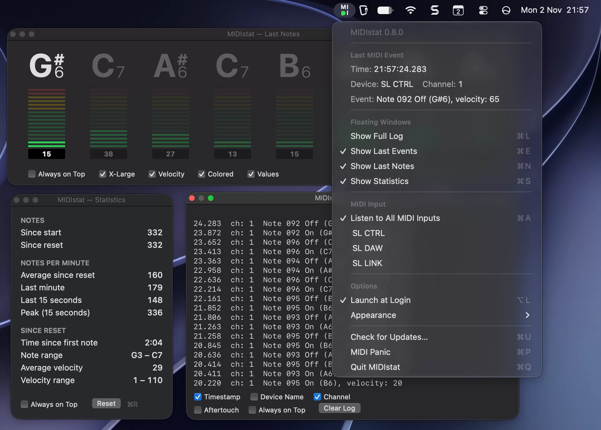
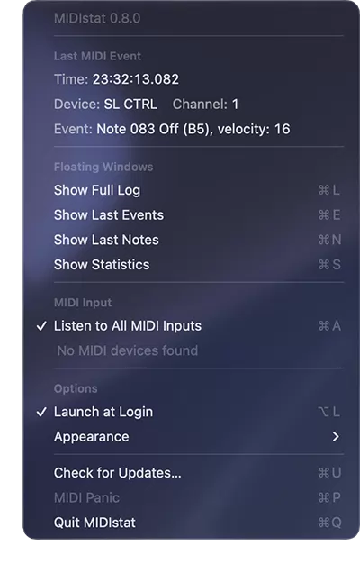
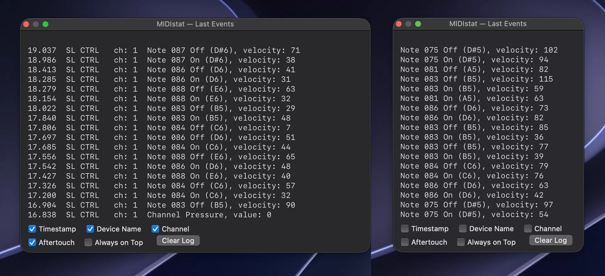
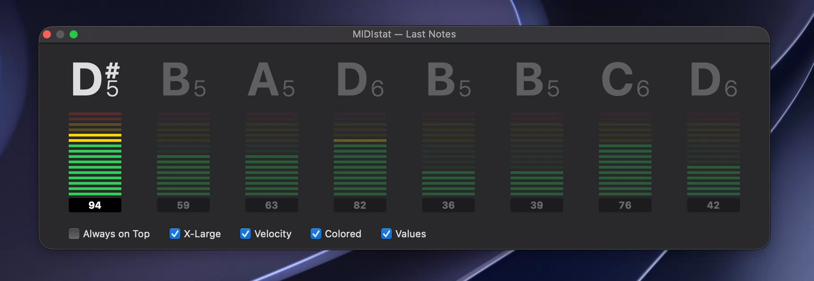
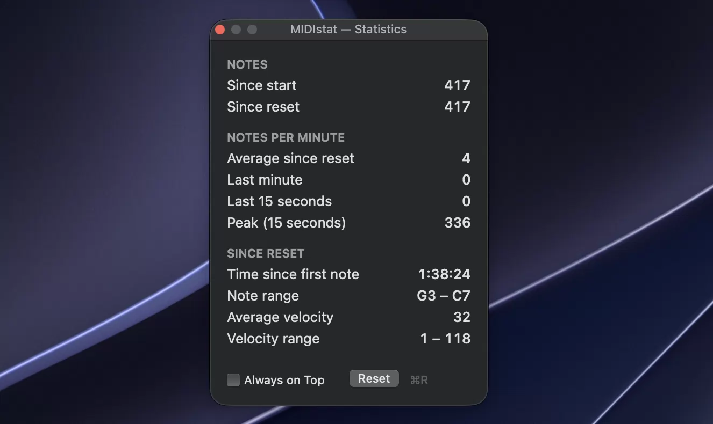
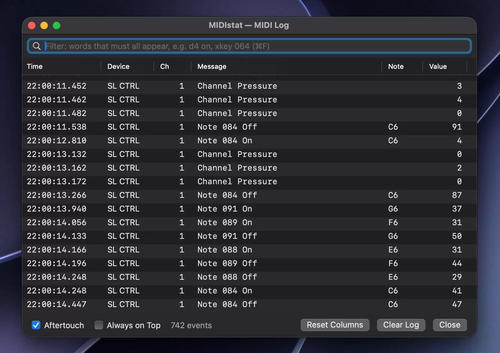

# MIDIstat

**Is MIDI arriving, and what is it? MIDIstat answers at a glance, right in your Mac's menu bar.**

Plug in a keyboard, a controller or an interface, and the small **MI / DI** mark in the menu bar lights up green the moment MIDI comes in.

| D | Meaning |
|---|---|
| $\color{green}{◗}$ **green** | a MIDI message was received within the last second |
| $\color{gray}{◗}$ **grey** | listening, but nothing has arrived for over a second |
| $\color{red}{◗}$ **red** | not listening: there is no MIDI input, or the selected input is disconnected |

No more guessing whether the cable, the driver or the DAW is the problem. And when you want more than a light, MIDIstat opens small floating windows that show exactly what you play.

MIDIstat is **free and open source, and always will be**. No account, no ads, no tracking. It connects to the internet only when you check for updates.

## Why MIDIstat

- **Instant answer.** One glance at the menu bar tells you whether MIDI is arriving.
- **See every message.** The menu shows the last event live: device, channel, note, velocity, controller, pitch bend, aftertouch and more.
- **Floating windows you place anywhere.** Four small windows show the last events, the notes you play, practice statistics and the full log. Arrange them around your screen, keep them on top of every app and every desktop, even over a full-screen DAW, or let them behave like ordinary windows.
- **A practice companion.** See the notes you played in large type, how hard you hit each key, and how many notes per minute you play.
- **Tempo and devices at a glance.** MIDI Clock shows as BPM with the transport state; instruments sending Active Sensing are named.
- **MIDI Panic** silences hanging notes on every output with one shortcut.
- **Native and light.** A tiny Swift app with no Dock icon, using a fraction of a percent of CPU when idle. Light and dark mode, keyboard shortcuts, settings remembered.
- **Safe one-click updates.** MIDIstat shows what's new, then downloads, verifies and installs the update for you.

## The menu

Click the mark to see the last MIDI event, MIDI Clock and Active Sensing while they arrive, and to open the windows, choose the MIDI input (all inputs, or just one), switch Launch at Login and the appearance (Auto, Light, Dark), check for updates or send MIDI Panic.

## The floating windows

Each window has its own options, including **Always on Top**, and opens again where you left it. They never steal the focus from the app you are working in.

### Last Events (⌘E)

The most recent MIDI messages as compact text, updated the instant they arrive. Choose the columns (time, device, channel) and whether to include the flood of aftertouch messages. Make it as wide or tall as you like.

### Last Notes (⌘N)

The last notes you played in large, clear type, for example G₄ C♯₄ D₄, the newest on the left. Ideal when learning: play and see what you played.

- **Velocity**: a meter under each note shows how hard you pressed the key, optionally **Colored** like a level meter (green, yellow, red) and with the exact **Values**.
- **X-Large** doubles the size, readable from across the room.
- Widen the window to see more notes.

### Statistics (⌘S)

Numbers for your practice: notes played, notes per minute (average, last minute, last 15 seconds, peak), time played, the range of notes and the range of velocity. **Reset** (⌘R) starts measuring a new exercise.

### Full Log (⌘L)

Every MIDI message since MIDIstat started (up to 100,000), in a table with time, device, channel, message, note and value. Filter it by typing a few words, such as `d4 on` or `ch 2`, and copy rows straight into a spreadsheet.

## Download

Get the latest **MIDIstat-x.y.z.zip** from [Releases](https://github.com/barabasz/midistat/releases/latest). It runs on macOS 14 or later, on Apple silicon and Intel.

1. Unzip it (Safari does this automatically) and move **MIDIstat.app** to **Applications**.
2. Open it. MIDIstat is not notarized by Apple, so the first time macOS blocks it. Allow it in **System Settings → Privacy & Security → Open Anyway**, or run `xattr -dr com.apple.quarantine /Applications/MIDIstat.app` in Terminal.

MIDIstat then appears in the menu bar. Later versions install from the menu: **Check for Updates…**

## For power users and developers

Everything MIDIstat does can also be controlled from Terminal, scripts or AI assistants: `MIDIstat ctl status`, `ctl open notes`, `ctl events 5` and more. How MIDIstat works, how to build it and the command-line reference are in [DEVELOPMENT.md](DEVELOPMENT.md).

## License

[MIT](LICENSE) © Andrew Barabasz (github/barabasz)
