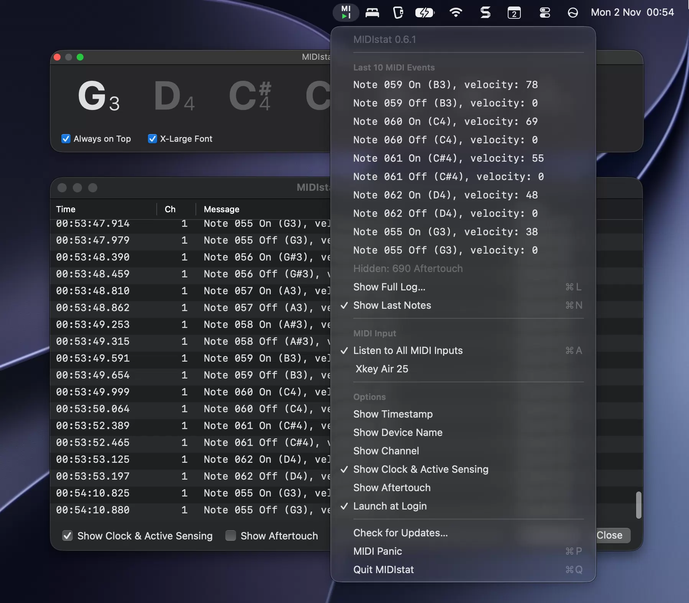

# MIDIstat

A tiny native macOS menu bar app that shows, at a glance, whether MIDI data is arriving — and what it is.



MIDIstat has no Dock icon and no main window. It lives in the menu bar as a two-row **MI / ▶I** mark; the triangle is the indicator:

| Triangle | Meaning |
|---|---|
| $\color{green}{▶}$ **green** | a MIDI message was received within the last second |
| $\color{gray}{▶}$ **grey** | listening, but nothing has arrived for over a second |
| $\color{red}{▶}$ **red** | not listening: there is no MIDI input, or the selected input is disconnected |

The red state applies even if other devices are connected: when a specific input is selected and it disappears, MIDIstat is not listening to anything. It turns grey again automatically when the device comes back.

## Features

### Menu

Click the icon to open the menu. Its first line shows the installed version, e.g. *MIDIstat 0.7.0*.

- **Last MIDI Event**: the most recent message, updated live while the menu is open:
  ```
  Time: 14:03:22.841
  Device: Xkey Air 25    Channel: 1
  Event: Note 079 On (G5), velocity: 93
  ```
  It shows every kind of message, aftertouch included. This is the quick check whether an interface works at all, or whether a keyboard sends aftertouch: while a key is held you see its pressure value, after release the Note Off.
  Below it, only while they arrive, MIDIstat shows two summaries (see [Clock and Active Sensing](#clock-and-active-sensing)):
  ```
  MIDI Clock: 120.0 BPM, running (Ableton Live)
  Active Sensing: Yamaha P-125
  ```
- **Floating Windows**: **Show Full Log** (⌘L), **Show Last Events** (⌘E), **Show Last Notes** (⌘N) show or hide the three windows described below. Each item is checked while its window is open.
- **MIDI Input**:
  - **Listen to All MIDI Inputs** (⌘A), or
  - one specific input. Inputs are listed live as devices are connected and disconnected. A selected input that is currently unplugged appears as `Name (disconnected)`.
- **Options**:
  - **Launch at Login** (⌥L, hold Option while the menu is open): start MIDIstat automatically when you log in.
- **Check for Updates…** (⌘U): asks GitHub for the latest release.
  - If you have the latest version, a dialog says so.
  - Otherwise a dialog shows the new version and what's new since your version, covering every release you skipped. It lists up to 5 changes, newest first, then *…and N more* with a **See all changes** link to GitHub's comparison of your version with the new one. The buttons are **Upgrade** and **Cancel**. **Upgrade** downloads the new version and checks it: GitHub's SHA-256 checksum, the app identifier, the version and the code signature. It then replaces the installed app in place, keeping your settings, and restarts MIDIstat. If something fails, the old version stays and you can open the release page.
- **MIDI Panic** (⌘P): sends *All Sound Off*, *Reset All Controllers* and *All Notes Off* on all 16 channels to every MIDI output, to silence hanging notes. It is disabled when there are no MIDI outputs.
- **Quit MIDIstat** (⌘Q).

The window shortcuts ⌘L, ⌘E, ⌘N and ⌘P also work while one of MIDIstat's windows has focus. All settings, including the selected input, the windows' options and which windows are open, are remembered between launches.

### Windows

Each window has its own options and its own **Always on Top** checkbox. With **Always on Top** on, the window floats above other windows, on every desktop (Space) and over full-screen apps. With it off, the window behaves like an ordinary window: it stays on the desktop where you left it and does not appear in full-screen apps. If you turn it off while a full-screen app is in front, the window hides there at once and reappears on the next regular desktop you switch to, so it never gets stuck in a full-screen app.

**Aftertouch** (poly and channel pressure) is off by default in the windows that list events. Holding a key produces a flood of these messages, which would push the notes out of view. Hidden messages still turn the indicator green.

### Last Events window

**Show Last Events** opens a compact text window, *MIDIstat — Last Events*, with the most recent events, newest at the bottom. It updates the moment an event arrives:

```
 2.140  Xkey Air 25   ch: 1  Note 069 Off (A4), velocity: 0
 2.340  Xkey Air 25   ch: 1  Note 071 On (B4), velocity: 90
```

- Options: **Timestamp** (seconds and milliseconds within the minute), **Device Name**, **Channel**, **Aftertouch**, **Always on Top**, and a **Clear Log** button (it clears the shared history: Last Events, the log and the menu).
- Turning a column on or off sets the width to fit all columns. You can then make the window narrower, and long descriptions end with "…", or wider. The height can be changed too: at least 5 lines, up to the screen height, and more lines show more events.
- The window never takes the focus away from the app you are using. If it is open when you quit MIDIstat, it opens again at the next launch.

### Log window

**Show Full Log** opens a resizable window (it can also be zoomed or made full screen) with a table of every message since MIDIstat started, or since the log was last cleared:

- a **filter** field at the top (⌘F). Type one or more words, and only rows containing all of them stay, in any column and ignoring case. For example, `d4 on` shows Note On events of D4, `xkey 064` events from the Xkey with controller or note 064, `ch 2` events on channel 2. New events that match keep appearing;
- columns **Time** (`HH:mm:ss.SSS`), **Device**, **Ch**, **Message** and **Value** (velocity, controller value, pressure, pitch bend; empty for messages without one);
- **Aftertouch** and **Always on Top** checkboxes;
- an event counter, including how many messages are hidden;
- **Clear Log** clears the history: the log, Last Events and the menu;
- **Close** (or Esc; while typing in the filter, Esc clears it first).

The window comes to the front when opened. While it has focus, **⌘L** closes it again. Selected rows can be copied with **⌘C** as tab-separated text, ready to paste into a spreadsheet. **⌘A** selects all rows. After a quiet moment, a new event appears at once. While MIDI streams in (fast passages, aftertouch), the table updates up to 10 times per second, so lines may arrive in pairs. Updating a table costs far more than the text of Last Events, so for a truly instant view use Last Events.

The log keeps up to the 100,000 most recent messages. The counter says so when the limit is reached.

### Last Notes window

**Show Last Notes** opens a small window, *MIDIstat — Last Notes*, with the last notes played, in large type, for example G₄ C♯₄ D₄ A₅ F♯₄. It is handy when learning: keep it open, press keys and see what you played.

- The newest note appears on the left with a short slide-and-fade animation and pushes the older notes to the right. The oldest note slides out.
- The newest note is shown at full contrast; the older ones are dimmed.
- Each note is a large bold letter with a small column to its right. The sharp sign, if any, is on top, level with the top of the letter. The octave number, in a light weight, is at the bottom, on the letter's baseline. Middle C is C4.
- **Notes count**: how many keys were pressed since MIDIstat started (each Note On counts, also while the window is closed). **Reset** sets it back to 0, e.g. to count the notes in one exercise.
- **Resizable horizontally**: by default the window shows 5 notes. Drag its edge to make it wider, up to the full screen width, and more notes fit. Notes played earlier appear at once. It cannot be made narrower than 5 notes, and the height is fixed.
- **X-Large Font** (default off) doubles the size of the notes. The window grows taller and keeps showing the same number of notes, as long as they fit on the screen.
- Only key presses (Note On) are shown. Releases and other MIDI messages are ignored. Pressing the same key again adds it again.
- **Always on Top** (default on), see [Windows](#windows).
- The window never takes the focus away from the app you are using.
- If the window is open when you quit MIDIstat, it opens again at the next launch, with the same position, width and options. Closing it turns the option off.
- With *Reduce motion* turned on in System Settings → Accessibility, notes appear without animation.

### Clock and Active Sensing

Two kinds of MIDI messages carry no musical content and arrive continuously, so MIDIstat summarises them instead of listing them:

- **MIDI Clock** synchronises tempo: a DAW, drum machine or sequencer sends 24 pulses per quarter note, 48 messages per second at 120 BPM. MIDIstat shows the tempo, whether the transport is running (Start / Stop / Continue) and the sending device. Start, Stop, Continue and Song Position are also listed as events.
- **Active Sensing** is a "still connected" signal that some instruments, often digital pianos, send every ~300 ms. MIDIstat shows which devices send it.

Both turn the indicator green. They appear in the menu, and in `ctl status`, only while they arrive. Ordinary controller keyboards send neither.

### Message format

Each line has the parts that are switched on: timestamp, device, channel, message.

- **Timestamp**: seconds within the current minute plus milliseconds (`4.841`). The log window shows the full time.
- **Channel**: 1–16. System messages have no channel (`12.345, Start`).
- **Notes**: zero-padded number plus name, with middle C = 60 = C4 (so 79 = G5). A *Note On with velocity 0*, which many keyboards send on key release, is shown as **Note Off**.
- **Message types**: Note On/Off, Poly Pressure, Control Change (common controllers are named, e.g. `Control Change 064 (Sustain), value: 127`), Program Change (raw value 0–127), Channel Pressure, Pitch Bend (`-8192…+8191`, 0 = centre), SysEx, MTC Quarter Frame, Song Position, Song Select, Tune Request, Clock, Start, Continue, Stop, Active Sensing, System Reset.

## Command-line control

The running app can be inspected and controlled from Terminal, scripts or AI assistants. The app binary doubles as the command-line tool:

```sh
MIDISTAT=/Applications/MIDIstat.app/Contents/MacOS/MIDIstat
$MIDISTAT ctl status                 # the whole state as JSON
$MIDISTAT ctl set log-aftertouch on  # change an option
$MIDISTAT ctl open notes             # show the Last Notes window
$MIDISTAT ctl events 5               # the last 5 events
```

| Command | Effect |
|---|---|
| `ver` | The installed version and build number. |
| `devices` | The MIDI inputs (and whether MIDIstat is listening to each) and outputs that MIDIstat sees. |
| `updates` | Checks GitHub for a newer release: the latest version, all changes since the installed one and a link to the full comparison. Does not install anything. |
| `status` | Indicator state, selected input, available inputs and outputs, all options, which windows are open, MIDI Clock and Active Sensing, the notes count, event counts. |
| `events [N]` | The last N events (default 10, max 1000), filtered like Last Events: time, device, channel, message. |
| `set <option> <on\|off\|toggle>` | Options: `events-timestamp`, `events-device`, `events-channel`, `events-aftertouch`, `events-on-top`, `log-aftertouch`, `log-on-top`, `notes-on-top`, `notes-xlarge`, `launch-at-login`. |
| `input all` / `input <name or ID>` | Listen to all inputs, or to one: its exact name (as in `status`) or unique ID. |
| `open <log\|events\|notes>` / `close …` | Show or hide a window. Opening does not take the focus away from the app you are using. |
| `clear-log` | Clear the event history, the same as **Clear Log**. |
| `reset-notes` | Reset the notes count in Last Notes. |
| `panic` | Send MIDI Panic to all outputs. |
| `help` | List the commands. |

Every reply is JSON with `"ok": true` or `"ok": false` and an `"error"` message. Commands that change something reply with the new `status`. Changes take effect, and are saved, exactly as if made in the menu.

The exit code is 0 on success, 1 when the app reports an error and 2 when MIDIstat is not running.

The tool talks to the app through a local socket in `~/Library/Application Support/MIDIstat/`. Only your user account can access it, and nothing is opened on the network.

To type just `midistat ctl status`, add an alias to your shell profile:

```sh
alias midistat=/Applications/MIDIstat.app/Contents/MacOS/MIDIstat
```

## Download

Get the latest **MIDIstat-x.y.z.zip** from [Releases](https://github.com/barabasz/midistat/releases/latest). It runs on macOS 14 or later, on Apple silicon and Intel.

1. Unzip the download (Safari does this automatically) and move **MIDIstat.app** to **Applications**.
2. Open it. MIDIstat is not notarized by Apple, so the first time macOS blocks it. To allow it, either:
   - open **System Settings → Privacy & Security**, scroll down, click **Open Anyway** next to the MIDIstat message and confirm, or
   - run `xattr -dr com.apple.quarantine /Applications/MIDIstat.app` in Terminal.

## Building from source

Requirements: macOS 14 or later and the Xcode Command Line Tools (`xcode-select --install`). Full Xcode is not needed.

```sh
./scripts/build-app.sh               # builds build/MIDIstat.app (release, with icon, ad-hoc signed)
./scripts/build-app.sh --universal   # same, for Apple silicon + Intel
./scripts/build-app.sh --install     # replaces /Applications/MIDIstat.app and (re)starts it
swift run MIDIstatCheck              # runs the self-checks of the MIDI parsing/formatting logic
./scripts/benchmark.sh               # measures CPU and memory of the running app (see below)
```

### Benchmark

`./scripts/benchmark.sh` measures the CPU and memory use of the **running** MIDIstat (by default `/Applications/MIDIstat.app`). While it runs, virtual MIDI devices (`MIDIstatLoad`) play notes, aftertouch and MIDI Clock with Active Sensing, and the windows are switched through the control API. The result is a table per set of open windows:

```
Windows: events
  load                                    CPU   memory
  no MIDI                              0.00 %   35M
  6 notes/s                            2.98 %   35M
  16 notes/s                           5.64 %   35M
```

CPU is the average share of one core. Afterwards the windows that were open are reopened, and the event history and notes count are cleared if they were empty before. Options: `--quick` (fewer combinations); environment `RUN_SECONDS` (seconds per measurement, default 10) and `MIDISTAT_BIN` (another app binary). The windows open and close on screen while it runs. Use it after changes to the windows or the event handling, to compare with earlier results.

**Launch at Login** works most reliably when the app is in `/Applications` (use `--install`). If macOS asks for approval, the System Settings → General → Login Items pane opens; in the menu the option then shows a dash (–) until it is approved.

## Publishing a release

1. Bump `CFBundleShortVersionString` and `CFBundleVersion` in `Support/Info.plist`, then commit and push.
2. Run `./scripts/release.sh`.

The script checks that `main` is clean and in sync with GitHub and that the version tag does not exist yet. It then runs the self-checks, builds the universal app and zips it into `build/MIDIstat-<version>.zip`. Finally it shows the release notes and creates the GitHub release `v<version>`. The notes contain installation instructions, the zip's SHA-256, the list of commit titles since the previous release and a link to the full diff. It requires the GitHub CLI (`gh`) to be logged in.

| Option | Effect |
|---|---|
| `--dry-run` | only build and package |
| `--draft` | create the release as a draft |
| `--yes` | skip the confirmation prompt |

## How it works (for developers and AI assistants)

Swift Package with three targets, no third-party dependencies.
For more details see: [TECH.md](TECH.md).

## License

[MIT](LICENSE) © Andrew Barabasz (github/barabasz)
